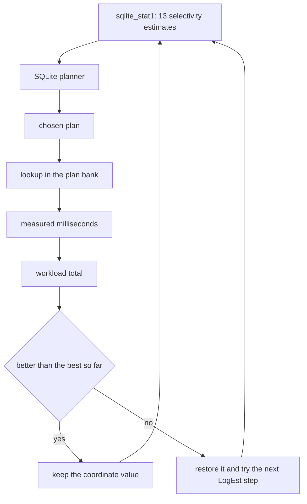
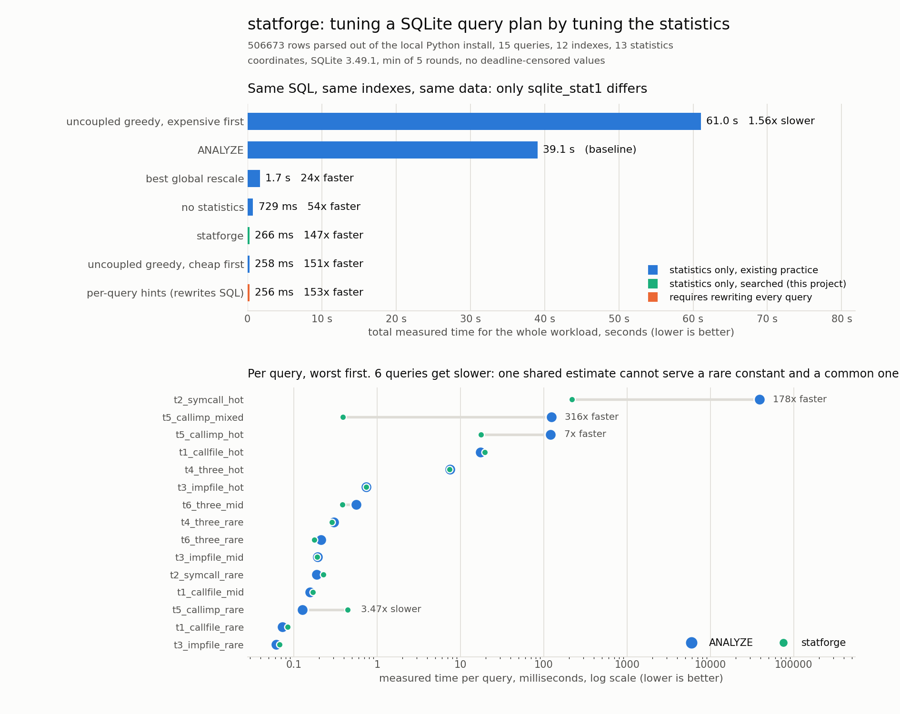

# statforge

Tune a SQLite query plan by searching the statistics table instead of rewriting the SQL.

## The problem

SQLite picks a query plan from `sqlite_stat1`. That table holds one integer per index column prefix: the average number of rows matching an equality test on that prefix. Builds compiled without `SQLITE_ENABLE_STAT4`, which is the default and is what ships inside CPython, have no per value histograms at all. This run verified it on the local interpreter: `stat4_enabled: false`.

One average per column is not enough information to plan a workload, because real columns are not uniform. Parsing the Python standard library and site-packages into a database gives a `calls` table with 396,850 rows and 18,963 distinct function names:

| column | rows | distinct | commonest value | singletons | what ANALYZE reports |
|---|---|---|---|---|---|
| `calls.func` | 396,850 | 18,963 | `assertEqual`, 44,875 rows | 5,139 | 21 |
| `imports.target` | 19,259 | 654 | `pip`, 2,093 rows | 144 | 30 |
| `symbols.name` | 88,056 | 48,267 | `__init__`, 2,940 rows | 38,885 | 2 |

`ANALYZE` is not wrong about `calls.func`: 21 really is the average. It is just that no query asks about the average. A query asking for `func = 'assertEqual'` gets 44,875 rows and a query asking for `func = '_utc_fold'` gets 1, and the planner costs both at 21.

Here are two queries from the workload. They are the same shape over the same tables and differ in one constant:

```sql
-- t5_callimp_mixed: a common function name, a rare import target
SELECT count(*) FROM calls AS c, imports AS i
 WHERE c.file_id = i.file_id AND c.func = 'assertEqual'
   AND i.target = 'inspect_fodder3';

-- t5_callimp_rare: a rare function name, the same rare import target
SELECT count(*) FROM calls AS c, imports AS i
 WHERE c.file_id = i.file_id AND c.func = '_utc_fold'
   AND i.target = 'inspect_fodder3';
```

Under `ANALYZE` both get the plan that drives the join from `calls.func`. For the second query that is exactly right and it runs in 0.13 ms. For the first it means scanning 44,875 rows to find the handful that matter, and it runs in 122.83 ms, 316 times slower than the alternative plan. One estimate serves both queries and no value of it is correct for both.

The usual answers are unattractive. `INDEXED BY` pins the plan but has to be written into the application's SQL at every call site, and SQLite raises an error if that index is ever dropped. Adding indexes does not help when the planner's problem is choosing between the indexes already present.

## What it does

`statforge` treats the statistics as a control input rather than as a measurement. The planner is a deterministic function of `sqlite_stat1`, so the question "which numbers in that table make the planner fastest on this workload" is a well posed search, and it is answered end to end:

1. **Build a real corpus.** Parse every `.py` file in the local Python installation with `ast` into four tables (`files`, `symbols`, `imports`, `calls`), 506,673 rows and 12 indexes. No downloads, and the value frequencies are genuinely skewed because real source code is.
2. **Enumerate the plans.** `CROSS JOIN` suppresses join reordering and `INDEXED BY` pins the index for one table reference, so every permutation of tables crossed with every per table index choice is reachable. 522 distinct plans across 15 queries.
3. **Time them for real, with a deadline.** The plan space contains nested loops that run for minutes, so every measurement runs under a progress handler that aborts it once a deadline passes. 129 plans finished inside 1 second, 393 were cut off.
4. **Ask the planner, cheaply.** `EXPLAIN QUERY PLAN` needs the schema and the statistics, never the rows, so a schema-only in-memory database answers "what plan would these statistics produce" without touching the 36 MB file.
5. **Search.** Coordinate descent over the 13 selectivity estimates, where each coordinate's candidate set is every value SQLite's `LogEst` fixed point representation can tell apart. Scoring a candidate is one `EXPLAIN QUERY PLAN` per query plus a lookup in the timing bank, so the whole search is 11.8 seconds and 237,623 planner calls with no query execution at all.
6. **Verify by execution.** Install the result in the real database and time the workload against every baseline, round robin, minimum over rounds.

The output is a `sqlite_stat1` table. The application's SQL does not change.

## Why this is interesting

**One table serves every query, so this is a joint problem.** There is no per query knob. Repairing one query's plan can spoil another's, which is why the result is a single search over a shared parameter vector and not fifteen independent fixes. The ablation below measures what happens when you ignore that.

**The estimate it falsifies is not the estimate that is wrong.** `ANALYZE`'s error is on `calls.func`: it reports 21 where the hot constant has 44,875 rows. That number cannot be fixed, because the rare constants need it to stay near 1. What the search does instead is understate a *different and accurate* estimate, `calls.file_id`, from 175 down to 11. The planner compares estimates against each other, so tilting an accurate one achieves the plan that correcting the inaccurate one cannot. The best statistics are not the truest statistics, and here they are measurably further from the truth.

**The search space is small because the representation is coarse.** SQLite stores estimates as `10 * log2(x)` in a 16 bit integer, so two estimates that round to the same `LogEst` are indistinguishable to the planner. A coordinate spanning 1 to 396,850 has fewer than 220 distinguishable values, which makes an exhaustive sweep per coordinate affordable and makes "distance from the truth" measurable in tenths of a bit.

**Measuring once and replaying is what makes it cheap.** Every plan's runtime is measured once into a bank, after which scoring a statistics vector costs microseconds. The expensive part happens 522 times, not 237,623 times.

## Architecture

FigJam board: https://www.figma.com/board/Vpira4y8h0Z3iu72upPG5G

The diagram shows how real source code becomes a skewed relational corpus, how the plan space for each query is enumerated and timed once into a bank, and how the schema-only planner oracle and that bank combine into a search whose output is a statistics table that gets installed and then measured for real.

Where a plan comes from, at the level of one query:



## Results



The metric is total measured wall clock time for a 15 query workload over a 506,673 row database, minimum of 5 rounds, every configuration visited round robin so none of them gets its own patch of machine time. The baseline is `ANALYZE`, which is what every SQLite deployment runs and what every piece of advice recommends.

| configuration | total | vs ANALYZE | changes SQL |
|---|---|---|---|
| uncoupled greedy, expensive first | 61,043.5 ms | 0.64x | no |
| **ANALYZE (baseline)** | **39,065.4 ms** | 1.00x | no |
| best single global rescale | 1,652.6 ms | 23.6x | no |
| no statistics at all | 729.1 ms | 53.6x | no |
| uncoupled greedy, cheap first | 258.4 ms | 151.2x | no |
| **statforge** | **266.1 ms** | **146.8x** | **no** |
| per query `INDEXED BY` hints | 255.6 ms | 152.8x | yes, every query |

Three results are worth more than the headline:

**Running `ANALYZE` made this workload 53 times slower than having no statistics at all.** The empty table is not a neutral baseline that statistics improve on. With no `sqlite_stat1` SQLite falls back to fixed defaults that happen to avoid the catastrophic plan here; the measured averages walk straight into it.

**Almost all of the gain is one query and one estimate.** `t2_symcall_hot` goes from 38,794 ms to 218 ms. Its plan changes in exactly one position:

```
ANALYZE  : SEARCH s USING INDEX ix_sym_name (name=?) ; SEARCH c USING INDEX ix_call_func (func=?)
statforge: SEARCH s USING INDEX ix_sym_name (name=?) ; SEARCH c USING INDEX ix_call_file (file_id=?)
```

The inner loop stops looking up by `func`, which it believes returns 21 rows and which actually returns 44,875, and starts looking up by `file_id`. Because the outer loop produces 2,940 rows, that is the difference between 2,940 lookups of 175 rows and 2,940 rescans of 44,875.

**Two queries got slower, and that is the thesis rather than an embarrassment.** `t5_callimp_rare` went from 0.13 ms to 0.44 ms and `t2_symcall_rare` from 0.19 ms to 0.23 ms. These are the rare constant halves of the pairs described at the top. The search gave up 0.35 ms spread across them to win 38.6 seconds elsewhere, which is the right trade and is only necessary because the estimate is shared.

### The ablations

**A single global rescale is not the same knob.** Multiplying every estimate by one factor, swept over four orders of magnitude, reaches 1,652.6 ms. The winning move is a change in the *ratio* between two estimates, and a global factor cannot produce one.

**Repairing queries one at a time is worse than doing nothing.** The uncoupled greedy optimises each query over the coordinates that affect it and keeps the change, which is what tuning by hand looks like. Visiting the expensive queries first, the obvious order, gives 61,043.5 ms, which is 1.57 times *slower* than the untouched baseline: the cheap queries are repaired last, get the last word on the shared estimates, and undo the one repair that mattered. Visiting them in the opposite order gives 258.4 ms. The outcome swings 236 times on an ordering with no defensible choice, which is the argument for solving it jointly.

**The result is close to what rewriting every query would buy.** Pinning each query to the best plan the enumeration found, using explicit `INDEXED BY` and `CROSS JOIN` in the SQL, reaches 255.6 ms. `statforge` gets to 266.1 ms, within 4 percent, without touching a line of SQL.

### Honest limits

- **The optimum is a region, not a point.** All five restarts reach 225.6 ms predicted while changing between 3 and 9 coordinates, because the chosen plan is a piecewise constant function of the statistics. The reported vector is the sparsest member of that plateau, chosen by a tie break; a different run can return a different member. One earlier run solved the same workload by changing a single coordinate.
- **The absolute numbers move between runs.** The workload total is dominated by one query that takes tens of seconds under `ANALYZE`, and it was measured at 26.1 s, 27.4 s, 35.3 s and 38.8 s on this machine at different times. The ratio stayed between 100x and 150x throughout. Everything in this README is from the single run recorded in `docs/metrics.json`.
- **The plan bank's prediction is a lower bound, not an estimate.** It censors at 1 second, so it predicts 3,018 ms for `ANALYZE` against 39,065 ms measured. The search only uses it to rank candidates; every number reported above is an end to end execution, and any query that hit the deadline was re-run once with no useful deadline so that no reported total is a bound.
- **The search can only choose plans it has measured.** 23 statistics vectors steered a query onto a plan the enumeration never produced; those are charged the deadline, so the search declines them rather than gambling.
- **Forged statistics do not survive `ANALYZE`.** Anything that re-runs `ANALYZE` overwrites them. Treat the output as a migration step to re-apply, not as a durable property of the database.
- **The result is specific to this workload.** It is a fit to 15 queries. A different query mix needs a different search, and nothing here claims the vector generalises.

## Gotcha worth knowing: you cannot reload `sqlite_stat1` in a live connection

SQLite binds the contents of `sqlite_stat1` to its in-memory schema when a connection first reads that schema. Editing the table afterwards updates the rows and changes nothing about planning, silently. Measured against fresh connection ground truth over 60 statistics changes and 15 queries:

| method | wrong |
|---|---|
| `ANALYZE sqlite_master`, legacy transactions | 52 of 60 |
| `ANALYZE sqlite_master`, autocommit | 52 of 60 |
| `commit()` then `ANALYZE sqlite_master` | 52 of 60 |
| schema cookie bump (create then drop a table) | 54 of 60 |

Deserialising a database image and then inserting statistics fails the same way and for the same reason. The version that works puts the statistics in place *before* anything reads the schema: a writer connection takes the new statistics and serialises itself, and a fresh reader deserialises that image. See `statforge/oracle.py`. There is a second trap underneath this one: Python's `sqlite3` caches prepared statements, and a cached statement keeps the plan it was compiled with, so even a correct reload can be invisible.

`tests/test_statforge.py::TestScorer::test_score_depends_on_the_vector_and_is_reproducible` is the regression test for exactly this failure, which produced a search that scored every candidate identically and reported a confident result that meant nothing.

## How to run it

Requires Python 3.11 or newer, because the oracle uses `sqlite3.Connection.serialize`.

```
pip install -r requirements.txt
python demo.py
```

The first run parses the local Python installation into `.cache/corpus.db`, which takes about 40 seconds and 36 MB, and is reused afterwards. A full run is about 6 minutes, most of it spent executing the slow plans that the comparison is about. It prints every stage and writes `docs/before_after.png` and `docs/metrics.json`.

Useful flags:

```
python demo.py --quick          # 350 source files, 2 rounds, separate output files
python demo.py --reuse-bank     # skip the plan timing pass and reuse the cached one
python demo.py --rounds 9       # more timing rounds
python demo.py --cap 30         # per query deadline, seconds
python -m unittest discover -s tests -v
```

To use the pieces directly against your own database and queries:

```python
from statforge import search, stats
from statforge.workload import Query

queries = [Query("sales_by_region", "count(*)",
                 [("orders", "o"), ("customers", "c")],
                 "o.customer_id = c.id AND c.region = 'EU' AND o.status = 'open'")]
base = stats.analyze_vector("shop.db")               # what ANALYZE measured
bank = search.PlanBank("shop.db", queries).build()   # enumerate and time the plans
scorer = search.Scorer(bank)
winner, restarts = search.multi_start(scorer, base)
stats.write_stats("shop.db", winner["vector"])       # install the result
```

## Example output

From the run recorded in `docs/metrics.json`, on Python 3.13.5 with SQLite 3.49.1 on Windows 11:

```
3. planner oracle fidelity
--------------------------
schema-only oracle vs the real database: 105 (vector, query) pairs, 0 mismatches, 5 distinct plan sets

5. search over statistics
-------------------------
  start ANALYZE                ->    225.6 ms  distance  103  coords moved  3
  start all estimates = nrow   ->    225.6 ms  distance   99  coords moved  8
  start all estimates = 1      ->    225.6 ms  distance  102  coords moved  8
  start ANALYZE scaled 0.1     ->    225.6 ms  distance  102  coords moved  8
  start ANALYZE scaled 10      ->    225.6 ms  distance  101  coords moved  9
  chosen: start ANALYZE, 225.6 ms, 3 of 13 coordinates changed
search took 11.8 s, 237623 planner calls, 29457 statistics reloads
best single global rescale: x0.02
uncoupled greedy: 3018.3 ms expensive first, 225.7 ms cheap first, against 3018.3 ms for doing nothing
unknown plans charged the deadline during the search: 23

what the search changed:
  calls    ix_call_file       nrow 396850  ANALYZE [175]          forged [11]           (-40 tenths of a bit)
  calls    ix_call_func       nrow 396850  ANALYZE [21]           forged [41]           (+10 tenths of a bit)
  symbols  ix_sym_file        nrow 88056   ANALYZE [40]           forged [1]            (-53 tenths of a bit)
  3 of 13 coordinates changed, total LogEst distance 103

6. end to end measurement
-------------------------
    round 1 of 5 done
    round 2 of 5 done
    round 3 of 5 done
    round 4 of 5 done
    round 5 of 5 done
measured 7 configurations over 5 rounds in 237.8 s
    re-measuring t2_symcall_hot under ANALYZE with no useful deadline
      t2_symcall_hot: 38794.1 ms
    re-measuring t2_symcall_hot under uncoupled greedy, expensive first with no useful deadline
      t2_symcall_hot: 49530.3 ms
replaced 2 deadline-censored lower bounds with real timings
every configuration returns identical answers for all 15 queries

configuration                           total vs ANALYZE  censored
no statistics                        729.1 ms     53.58x         0
ANALYZE                            39065.4 ms      1.00x         0
best global rescale                 1652.6 ms     23.64x         0
uncoupled greedy, expensive first   61043.5 ms      0.64x         0
uncoupled greedy, cheap first        258.4 ms    151.20x         0
statforge                            266.1 ms    146.81x         0
per-query hints (rewrites SQL)       255.6 ms    152.81x         0

predicted from the plan bank: ANALYZE 3018.3 ms, statforge 225.6 ms
measured end to end:          ANALYZE 39065.4 ms, statforge 266.1 ms

query                     ANALYZE    statforge    change  plan changed
t2_symcall_hot        38794.07 ms    218.18 ms    177.8x  yes
t5_callimp_mixed        122.83 ms      0.39 ms    316.4x  yes
t5_callimp_hot          120.99 ms     17.72 ms      6.8x  yes
t1_callfile_hot          17.44 ms     19.60 ms      0.9x  no
t4_three_hot              7.46 ms      7.44 ms      1.0x  yes
t3_impfile_hot            0.74 ms      0.74 ms      1.0x  no
t6_three_mid              0.56 ms      0.39 ms      1.5x  yes
t4_three_rare             0.30 ms      0.29 ms      1.1x  yes
t6_three_rare             0.21 ms      0.18 ms      1.2x  yes
t3_impfile_mid            0.19 ms      0.19 ms      1.0x  no
t2_symcall_rare           0.19 ms      0.23 ms      0.8x  yes
t1_callfile_mid           0.16 ms      0.17 ms      0.9x  no
t5_callimp_rare           0.13 ms      0.44 ms      0.3x  yes
t1_callfile_rare          0.07 ms      0.08 ms      0.9x  no
t3_impfile_rare           0.06 ms      0.07 ms      0.9x  no
```

Note the last two lines, and note that `t5_callimp_rare` and `t5_callimp_mixed` are the same query with one constant changed. The forged `calls.func` estimate of 41 is not closer to the truth than `ANALYZE`'s 21; the hot value really has 44,875 rows and the rare one really has 1. It is simply positioned so that the planner prefers the join order that wins on total time.

## Layout

| file | what it holds |
|---|---|
| `statforge/corpus.py` | builds the four table corpus out of the local Python install |
| `statforge/workload.py` | the 15 queries, with constants drawn from measured value frequencies |
| `statforge/plans.py` | forced plan enumeration via `CROSS JOIN` and `INDEXED BY` |
| `statforge/bench.py` | deadline capped timing, round robin configuration comparison |
| `statforge/stats.py` | `sqlite_stat1` read and write, `LogEst` grid, the statistics vector |
| `statforge/oracle.py` | the schema-only planner, and the reload mechanism that works |
| `statforge/search.py` | the plan bank, the scorer, coordinate descent and the ablations |
| `statforge/chart.py` | the figure |
| `demo.py` | the end to end run |
